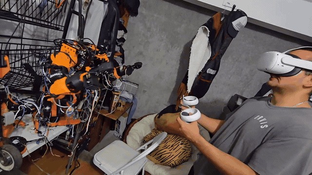
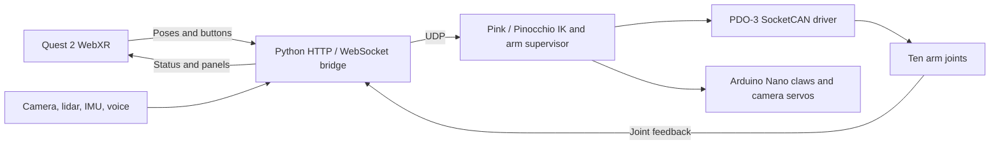
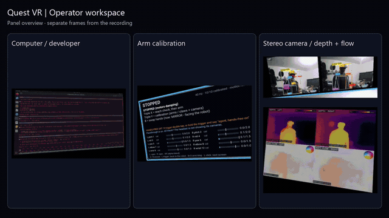

# Berkeley Humanoid Lite — Quest VR Teleoperation

**Control physical humanoid arms from a Quest 2 browser, with calibration and robot feedback in the headset.**

I built the WebXR-to-robot control path: controller poses → inverse kinematics → SocketCAN commands. The system adds per-joint power calibration, gravity feedforward, grip-based motion gating, and live tuning on a Linux Intel N150 PC beside the robot.

[](https://jose-sanchez-portfolio-com.vercel.app/media/humanoid-vr/quest-vr-teleop.mp4)

*Physical arm control from the October 1 recording, at the recorded playback rate. [Watch the complete 16.5-second preview](https://jose-sanchez-portfolio-com.vercel.app/media/humanoid-vr/quest-vr-teleop.mp4). Qualitative hardware evidence, not a tracking benchmark.*

[Hardware video and case study](https://jose-sanchez-portfolio-com.vercel.app/projects/berkeley-humanoid-vr/) · [Operator guide](docs/VR_TELEOP.md) · [As-built lab notes](arm_validation/TELEOP_AND_ARM_BRINGUP.md)

## Problem and contribution

The upstream robot uses SteamVR and Vive controllers. I replaced that input path with Meta Quest 2 tracking in the Quest Browser and integrated the transport, IK, arm drivers, calibration, diagnostics, and headset feedback for this robot's wiring.

The same headset flow can drive physical arms or an offline joint model. The offline driver includes PD control, gravity, friction, torque limits, and end stops for rehearsal and software checks. This work covers arm teleoperation; learned locomotion and walking-policy transfer are separate projects.

## Latest recorded evidence

Documentation and previews refreshed **October 14, 2026**. Hardware evidence remains the September 24 calibration/step tests and October 1 teleoperation recording; this refresh does not introduce a new hardware trial.

| Check | Recorded result | Scope |
| --- | --- | --- |
| Hardware integration | Controller tracking, UDP reception, arming, and joint movement recorded | Ten joints on two 1-Mbps arm buses; this unit's right wrist is ID 12. [Lab notes](arm_validation/TELEOP_AND_ARM_BRINGUP.md) |
| Power calibration · Sep 24 | **10/10 joints recorded `OK`** | Joint-specific torque ceilings and gravity fits; not a manipulation-success rate. [Report](arm_validation/calibration_20260924_1111.md) |
| Closed-loop wrist test · Sep 24 | ±10° steps and returns passed; 90% response in **0.23–0.25 s** | One left-wrist session and test condition. [Report](arm_validation/closed_loop/20260924_110748_can0_id9/report.txt) |

## How it works



| Source | Responsibility |
| --- | --- |
| [WebXR page](scripts/teleop/quest_bridge.html) / [bridge](scripts/teleop/quest_bridge.py) | Controller input, transports, headset panels, and status relay |
| [Arm supervisor](scripts/teleop/run_teleop.py) | IK, arming, grip gating, calibration, and live tuning |
| [Driver](scripts/teleop/arm_driver.py) / [power model](scripts/teleop/arm_power.py) | Hardware/offline drivers, batched CAN replies, gravity feedforward, and torque limits |
| [Validation records](arm_validation/) | Calibration reports, encoder audits, closed-loop probes, and session logs |

## Engineering decisions

- **Batch CAN commands.** Send PDO-3 position/feedforward messages together and collect replies against one deadline; serial per-joint waits timed out over USB CAN.
- **Require deliberate motion input.** Start in damping, require explicit arming and held grip, reject estimated controller poses, and guard the arm adapters' USB identities.
- **Calibrate each joint.** Fit gravity compensation and constrain torque to calibrated limits. Live profiles persist and support undo.
- **Separate expensive helpers.** Voice, cameras, screen sharing, and control run in separate processes; heavy vision runs only when requested.

The headset includes stereo camera views, lidar/IMU panels, Depth Anything V2 relative depth, and RAFT optical flow. Depth is rescaled per image, not calibrated metric stereo depth. The CPU vision grid refreshes slowly and does not close the arm-control loop.

### Operator panels

[](https://jose-sanchez-portfolio-com.vercel.app/projects/berkeley-humanoid-vr/)

*12.5-second excerpt of the existing recording. The overview combines separate source frames; stereo/depth plays at 1.5×. The oversized IMU close-up has been removed. [Clip provenance](docs/previews/manifest.json).*

## Setup and operation

Requires Linux, Python 3.10, tmux, the upstream robot assets and low-level dependencies, and a provisioned `.venv` using the workspace's [package configuration](pyproject.toml) and [lockfile](uv.lock). Vision and voice helpers additionally need their models and system services. The [operator guide](docs/VR_TELEOP.md) describes this configured rig; a minimal standalone teleop installer is not yet provided.

```bash
git clone --recurse-submodules https://github.com/joses2017smjh/quest-vr-teleop.git
cd quest-vr-teleop
# After provisioning .venv and the optional helper dependencies:
./scripts/teleop/bringup.py --sim
./scripts/teleop/bringup.py status
```

The submodules use SSH URLs, so cloning them requires GitHub SSH access or locally changing those URLs to HTTPS. `--sim` avoids CAN and motors but still starts camera, sensor, and other helper processes. Open the printed headset URL and configure the secure-origin/USB-localhost path documented for WebXR.

Hardware operation uses `./scripts/teleop/bringup.py` after verifying this unit's bus map and calibration, with both arms hanging at zero. Follow the operator guide: the startup pose sets the joint zero, and stock upstream bus assignments differ on this rig. Software stop/arming gestures do not replace a physical emergency stop.

## Software checks

From the configured environment:

```bash
.venv/bin/python tools/test_teleop_tuning.py
.venv/bin/python tools/test_voice_typer.py
.venv/bin/python tools/test_claude_sessions.py
# Separate Python environment with QuickJS:
python tools/test_quest_page.py
```

The tuning check uses simulated arms and a scratch profile. Voice/session checks require tmux. The page test uses stubbed browser objects; its geometry checks also invoke the provisioned `.venv` and need robot-model assets. These checks need no robot or headset and do not measure manipulation performance.

## Limits and attribution

This remains a lab prototype. Tracking depends on headset visibility, CAN timing can vary, and hardware validation is limited to the recorded setup. The calibration and single-joint checks do not establish general task reliability.

**Stack:** Python, JavaScript/WebXR, Pink, Pinocchio, QP IK, SocketCAN, Arduino, OpenCV, ONNX Runtime, PyTorch, Vosk, Whisper, Piper, and tmux.

My teleoperation fork builds on [Berkeley Humanoid Lite](https://github.com/HybridRobotics/Berkeley-Humanoid-Lite); the robot design is upstream work. [Upstream documentation](https://berkeley-humanoid-lite.gitbook.io/berkeley-humanoid-lite-docs). Code: [MIT](LICENCE). Upstream assets retain their respective terms, including CC BY-SA 4.0 where specified.
